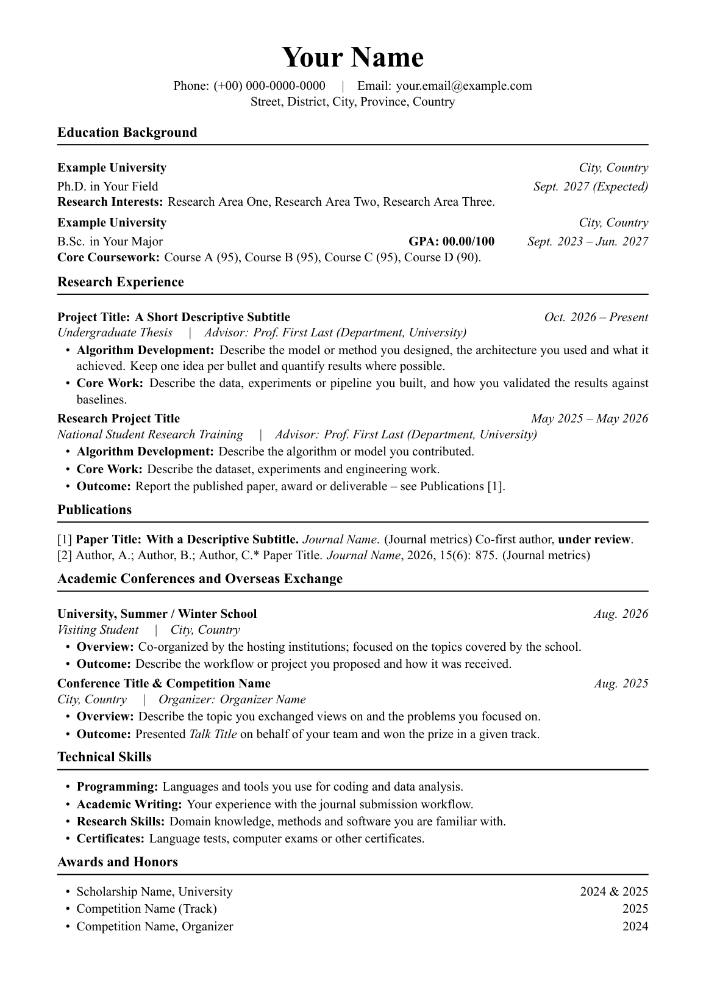

# LaTeX English Resume Template

[](https://github.com/Evruc-zang/latex-resume-template/actions/workflows/build.yml)

A clean, single-column academic English resume (CV) template built with XeLaTeX.
It uses a classic Times-style layout: a centered header, bold section headings with
a thin rule, and one tight two-column macro for every "title + date" line, so the
whole document stays aligned without manual spacing tweaks.



## Features

- **One-page-per-section clean grid** — every entry is a `\cvline{left}{right}` heading
  with the date/city flush right on a fixed 4.3 cm column, so nothing drifts.
- **Consistent bullet blocks** — the `cvitems` environment gives compact, evenly spaced
  bullets with bold lead-ins (`Algorithm Development:`, `Core Work:`, `Outcome:`).
- **Portable fonts** — Times New Roman when installed, automatic fallback to
  TeX Gyre Termes on stock TeX Live / Overleaf.
- **No overfull lines** — `\emergencystretch` plus `\mbox{}`-wrapped dates keep long
  headings from wrapping their dates onto a second line.
- **A4, 11 pt, 1.7 cm margins** — dense but readable; fits a full academic profile in
  two pages.

## Requirements

- XeLaTeX (TeX Live 2020+, MiKTeX, or MacTeX). LuaLaTeX also works.
- Packages used: `geometry`, `fontspec`, `tabularx`, `enumitem`, `titlesec`, `hyperref`
  (all part of a full TeX installation).

## Build

```bash
xelatex resume.tex
```

or, to handle reruns automatically:

```bash
latexmk -xelatex resume.tex
```

On Overleaf: upload `resume.tex`, open *Menu → Compiler* and select **XeLaTeX**.

## Customization

| What | Where |
| --- | --- |
| Name, phone, email, address | the `center` block at the top of the document |
| Section order | move the `\section*{...}` blocks; headings are plain text, no numbering |
| Entry heading + date | `\cvline{\textbf{Title}}{\mbox{\textit{Month Year}}}` |
| Role / advisor line | an italic line right below the `\cvline`, e.g. `\textit{Advisor: Prof. X}` |
| Bullets | wrap them in `\begin{cvitems} ... \end{cvitems}` |
| Right-hand column width | the `R{4.3cm}` argument of `\cvline` |
| Section rule / spacing | `\titleformat` and `\titlespacing*` in the preamble |
| Margins / font size | `geometry` options and `\documentclass[11pt,a4paper]` |

Tips:

- Keep short right-hand strings inside `\mbox{...}` so a long title cannot break them.
- Use `--` for an en dash in date ranges (`Sept. 2023 -- Jun. 2027`).
- Add `\newpage` before a section if you want a deliberate page break.

## Project layout

```
.
├── resume.tex                  # the template
├── preview.png                 # rendered preview used in this README
└── .github/workflows/build.yml # CI: compiles the PDF and uploads it as an artifact
```

## Continuous integration

`.github/workflows/build.yml` compiles `resume.tex` on every push and pull request with
a full TeX Live image, then uploads the resulting PDF as a build artifact — useful for
spotting LaTeX errors without a local toolchain.

## Acknowledgement

Layout inspired by common academic resume templates; typesetting code written from
scratch with `tabularx` + `titlesec`.
